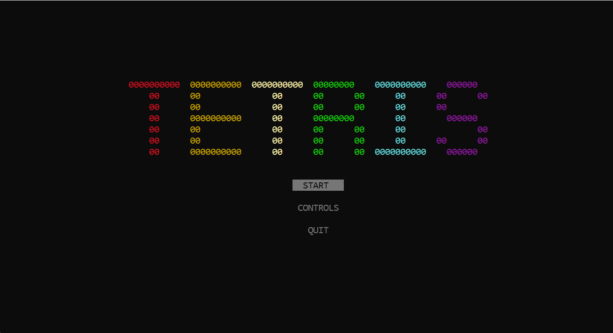
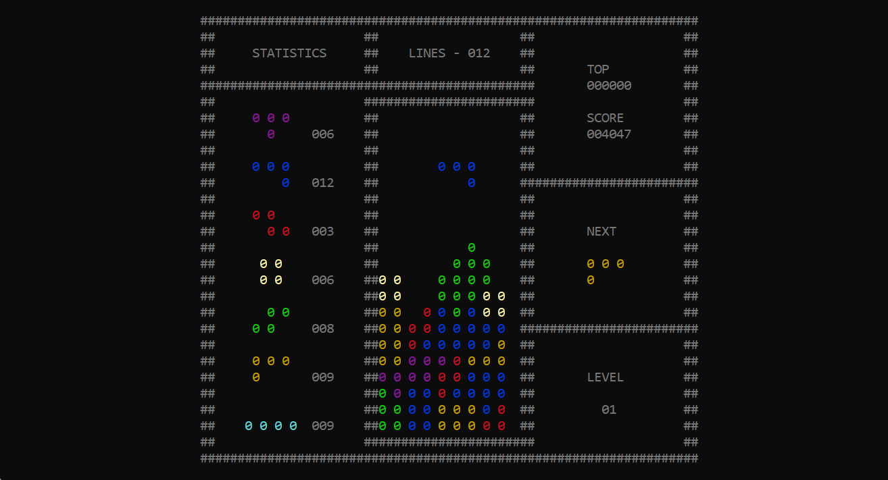

## Console Tetris

I created a Tetris clone that runs in the Windows console. It is built in C++ using the Windows API. I followed the layout and behavior of Tetris for the Nintendo Entertainment System, but imparted a unique style using ASCII art and the 16 colors available in the Windows console.

